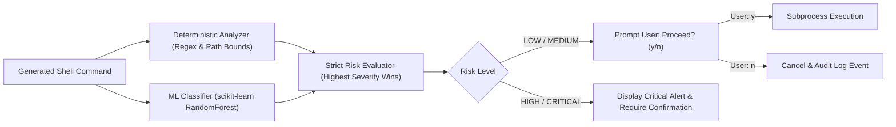

# 🐚 SmartShell 2.0 & OS Digital Twin — Comprehensive Master Guide

> **Project Title**: SmartShell: Intelligent Command-Line Operating System Assistant Using NLP & OS Digital Twin  
> **Target Audience**: Evaluators, Professors, Students, and First-Time Developers  
> **Version**: 2.0.0 (Production-Ready)  
> **Status**: Verified & Passing 21/21 Automated Tests  

---

## 📖 Table of Contents

1. [Executive Summary: What is SmartShell?](#1-executive-summary-what-is-smartshell)
2. [The Core Philosophy: The Two Pillars](#2-the-core-philosophy-the-two-pillars)
   - [Pillar 1: The Real Operating System NLP Assistant](#pillar-1-the-real-operating-system-nlp-assistant)
   - [Pillar 2: The SmartShell OS Digital Twin](#pillar-2-the-smartshell-os-digital-twin)
3. [Quick Start in 3 Minutes (How to Run Everything)](#3-quick-start-in-3-minutes-how-to-run-everything)
4. [High-Level System Architecture](#4-high-level-system-architecture)
5. [Pillar 1 Deep Dive: The 12 Real-OS AI/ML Enhancements](#5-pillar-1-deep-dive-the-12-real-os-aiml-enhancements)
6. [Pillar 2 Deep Dive: The SmartShell OS Digital Twin](#6-pillar-2-deep-dive-the-smartshell-os-digital-twin)
   - [Shared SimulationState Architecture](#shared-simulationstate-architecture)
   - [Virtual Process Manager & PCB Lifecycles](#virtual-process-manager--pcb-lifecycles)
   - [Virtual Memory Manager & Contiguous Partitions](#virtual-memory-manager--contiguous-partitions)
   - [Isolated Virtual Disk & Head Scheduling](#isolated-virtual-disk--head-scheduling)
   - [Virtual Resources, Banker's Algorithm & RAG Cycles](#virtual-resources-bankers-algorithm--rag-cycles)
   - [CPU Scheduler & Gantt Chart Generation](#cpu-scheduler--gantt-chart-generation)
   - [Scenario Service & Side-by-Side Algorithm Comparison](#scenario-service--side-by-side-algorithm-comparison)
   - [State Invariant Verification Engine (11 Rules)](#state-invariant-verification-engine-11-rules)
7. [Exhaustive Master CLI Command Reference](#7-exhaustive-master-cli-command-reference)
8. [Supporting Web Dashboard (12-Page Observability Tour)](#8-supporting-web-dashboard-12-page-observability-tour)
9. [Safety & Machine Learning Risk Classifier](#9-safety--machine-learning-risk-classifier)
10. [Automated Verification & Test Suite](#10-automated-verification--test-suite)
11. [Teacher / Evaluator Presentation & Live Demo Blueprint](#11-teacher--evaluator-presentation--live-demo-blueprint)
12. [Frequently Asked Questions (FAQ) & Academic Defenses](#12-frequently-asked-questions-faq--academic-defenses)

---

## 1. Executive Summary: What is SmartShell?

If you are reading about **SmartShell** for the very first time, think of it as solving two distinct challenges in computer science and operating systems:

```text
                  THE TWO MAJOR CHALLENGES SMARTSHELL SOLVES:
                                       |
       +-------------------------------+-------------------------------+
       |                                                               |
       v                                                               v
CHALLENGE 1: Terminal Cryptic Complexity        CHALLENGE 2: Abstract OS Theory
- PowerShell/Bash require exact syntax.         - Operating system algorithms (CPU scheduling,
- Typos can execute destructive commands.       memory allocation, Banker's algorithm)
- No conversational memory or pronoun target.   are taught as static formulas on whiteboards
- Users need an intelligent NLP assistant.      without an integrated, live interactive engine.
```

**SmartShell 2.0** solves both problems simultaneously:
1. It is a **context-aware, safe, natural-language command-line assistant** for your physical Windows machine. You speak in plain English (*"find all python files in C:\ and count them"*), and SmartShell translates, safety-checks, and executes native commands.
2. It is an **integrated OS Digital Twin** — a pure in-memory virtual operating system where processes, RAM blocks, disk files, and resource matrices interact dynamically on a single shared state model, allowing students and engineers to experiment with scheduling, memory fragmentation, Banker's deadlock safety, and state invariants.

---

## 2. The Core Philosophy: The Two Pillars

### Pillar 1: The Real Operating System NLP Assistant
* **Target**: Your actual Windows OS (PowerShell / CMD).
* **Interface**: Interactive Terminal CLI (`main.py`).
* **Capabilities**:
  * Translates plain English into native Windows commands (`Get-ChildItem`, `git`, `python`, etc.).
  * Remembers multi-turn context (e.g., *"search for PDF files"* → *"now move them to Documents"*).
  * Evaluates every command with a **dual safety engine**: a deterministic rule analyzer + a `scikit-learn` `RandomForestClassifier`.
  * Employs a **Local RAG (Retrieval-Augmented Generation)** subsystem that gives troubleshooting advice with citations when commands fail.
  * Automatically prunes execution history and log files older than **10 days** on startup.

### Pillar 2: The SmartShell OS Digital Twin
* **Target**: A software-simulated virtual operating system running in application RAM.
* **Key Concept**: **Shared Simulation State**. Unlike isolated online calculators where CPU scheduling and Banker's algorithm know nothing about each other, the Digital Twin runs on one synchronized state store (`SimulationState`).
* **Strict Boundary**: All virtual operations (spawning virtual processes, allocating virtual partitions, creating virtual files) are strictly isolated. **It will never terminate a real Windows process or touch your Windows hard drive.**

---

## 3. Quick Start in 3 Minutes (How to Run Everything)

SmartShell requires **zero paid cloud infrastructure** and runs on any standard Windows machine with Python 3.10+ and Node.js.

### Step 1: Open 3 PowerShell Windows

#### Window 1: Start the FastAPI Backend Server
```powershell
.\scripts\start_backend.ps1
```
*(Runs on `http://127.0.0.1:8000` with Swagger docs at `/docs`)*

#### Window 2: Start the Supporting React Dashboard
```powershell
.\scripts\start_frontend.ps1
```
*(Runs Vite on `http://localhost:5173`)*

#### Window 3: Start the Primary CLI Terminal
```powershell
.\venv\Scripts\python.exe main.py
```

### Step 2: Test It Live in the Terminal
* Type: `show all python files in this project` (Tests Real OS Assistant)
* Type: `how many were there?` (Tests Context Memory & Pronoun Resolution)
* Type: `dt status` (Tests Digital Twin Virtual OS State)
* Type: `dt schedule round robin quantum 2` (Tests Virtual CPU Scheduler & Gantt Chart)
* Type: `dt compare` (Tests Side-by-Side Algorithm Benchmarking)
* Type: `dt deadlock check` (Tests Banker's Algorithm Safe State)

---

## 4. High-Level System Architecture

```mermaid
flowchart TD
    subgraph Primary Interface
        CLI["SmartShell CLI Terminal (main.py)"]
    end

    subgraph Observability Dashboard
        WebUI["React 18 + TypeScript Web Dashboard (Port 5173)"]
    end

    subgraph Backend Core (FastAPI :8000)
        API["FastAPI REST & WebSockets Router"]
        
        subgraph Real OS Intelligence Engine
            CM["Context Manager (Session Memory & Pronouns)"]
            NLP["NLP Intent Parser (llm_translate.py)"]
            Safety["Dual Safety: Regex Rules + RandomForest ML"]
            RAG["Local RAG Search & Troubleshooting"]
            Executor["Subprocess Host Command Executor"]
        end

        subgraph SmartShell OS Digital Twin
            DTE["DigitalTwinEngine Coordinator"]
            State[("Shared SimulationState Singleton")]
            PM["Process Manager (PCBs & States)"]
            MM["Memory Manager (Partitions & Paging)"]
            DM["Disk Manager (Isolated Virtual FS)"]
            RM["Resource Manager (Available/Claim/Need Matrices)"]
            Sched["CPU Scheduler & Gantt Engine"]
            Deadlock["Deadlock Engine (Banker's & RAG Cycles)"]
            Verify["State Invariant Verifier (11 Rules)"]
            Scenario["Scenario Service (Snapshots & What-If)"]
        end

        subgraph Database Layer
            DB[("SQLite smartshell.db (10-Day Auto Retention)")]
            RAGDB[("SQLite smartshell_rag.db")]
        end
    end

    CLI --> CM
    CM --> NLP
    NLP --> Safety
    Safety --> Executor
    CLI --> DTE
    WebUI <-->|REST & WS| API
    API --> DTE
    API --> DB
    DTE <--> State
    State --- PM
    State --- MM
    State --- DM
    State --- RM
    State --- Sched
    State --- Deadlock
    State --- Verify
    State --- Scenario
    Executor --> DB
    Executor -->|On Error| RAG
    RAG <--> RAGDB
```

---

## 5. Pillar 1 Deep Dive: The 12 Real-OS AI/ML Enhancements

### 1. Context-Aware NLP Engine & Pronoun Resolution
- **Problem**: Standard shells forget previous commands immediately.
- **Solution**: `ContextManager` maintains a short-term memory vector of recent targets (`recent_files`, `recent_directories`, `active_drive`). When a user types *"count them"*, *"move that folder"*, or *"undo"*, it resolves the missing subject automatically.

### 2. Disambiguation & Multi-Drive Discovery
- **Problem**: Users frequently omit folder or drive paths (e.g. typing *"find project.docx"*).
- **Solution**: SmartShell detects ambiguity and prompts: `Which drive or folder would you like to target? (Available: C:\, D:\)`. If the user presses Enter (skips), it falls back to a safe, multi-threaded system-wide scan across all mounted physical drives.

### 3. Explainable DAG Task Planner
- **Problem**: Multi-step terminal commands (e.g., *"create folder ML, setup venv, install pandas, create main.py"*) often fail midway due to missing dependencies.
- **Solution**: SmartShell constructs a Directed Acyclic Graph (DAG) with explicit dependency links (`depends_on`), presenting an interactive execution plan for user approval.

### 4. Safe AI Error Diagnosis & Remediation
- **Problem**: Standard terminals output cryptic error traces that frustrate students.
- **Solution**: Errors are intercepted, classified into error types (`permission_denied`, `port_in_use`, `path_not_found`), and provided with safe, 1-click remediation commands.

### 5. Local RAG Knowledge Subsystem
- **Problem**: Cloud LLMs can hallucinate incorrect operating system commands.
- **Solution**: An embedded SQLite database (`smartshell_rag.db`) indexes local documentation and Windows guides, grounding troubleshooting advice with explicit source citations.

### 6. Feedback-Driven Personalization Engine
- **Problem**: Different users prefer different flags (e.g., PowerShell syntax vs CMD syntax).
- **Solution**: Users can save preferences (`prefer_python_venv=true`), and SmartShell applies them automatically to prompt translations.

### 7. Dual Safety Engine: Deterministic Rules + scikit-learn ML Classifier
- **Problem**: A language model must never be trusted to run commands without oversight.
- **Solution**: Every command is evaluated by two independent checkers:
  - **Deterministic Analyzer**: Blocks path traversal, formatting commands, and system directory modifications.
  - **Machine Learning Classifier**: A `RandomForestClassifier` trained on thousands of command patterns predicts risk (`LOW`, `MEDIUM`, `HIGH`, `CRITICAL`).
  - **Enforcement**: SmartShell always picks the **stricter** rating and requires explicit `y/n` confirmation.

### 8. Rolling Window Behavioral Anomaly Detector
- **Problem**: Compromised terminal sessions can execute bursts of high-risk actions.
- **Solution**: Tracks execution frequency, failure spikes, and risk distribution in a rolling 10-event window, alerting the user to abnormal behavior.

### 9. Modular AI Provider Architecture
- **Problem**: Reliance on paid cloud APIs causes failure when offline.
- **Solution**: An abstract provider factory allows seamless switching between Google Gemini (`gemini-3.5-flash-lite`) and deterministic offline rule-based translation.

### 10. NLP Dataset & Evaluation Benchmark Suite
- **Problem**: How do you measure the accuracy of natural-language translation?
- **Solution**: Includes a test dataset of 50+ annotated test cases (`backend/evaluation/dataset.json`) and an evaluation script (`eval_suite.py`) testing intent accuracy and risk classification recall.

### 11. Windows Multi-Drive Execution
- **Problem**: Most tools assume everything lives in `C:\Users`.
- **Solution**: Seamlessly operates across all partitions (`C:\`, `D:\`, `E:\`), tracking drive free space and finding duplicate files across drives using SHA-256 chunk hashing.

### 12. Automated 10-Day Retention & Audit Logging
- **Problem**: Unmonitored terminal logs cause disk bloat and privacy concerns.
- **Solution**: Automatically prunes execution records and audit logs older than 10 days upon backend startup, maintaining a clean database.

---

## 6. Pillar 2 Deep Dive: The SmartShell OS Digital Twin

The **SmartShell OS Digital Twin** is an integrated software simulation of an operating system's internal resources.

### Shared `SimulationState` Architecture
All subsystems interact through a thread-safe singleton store ([`state.py`](file:///c:/Users/Radhyeshyam%20lahoti/Downloads/SmartShell/backend/app/digital_twin/state.py)):
- **Logical Clock**: Tracks system progress in `ticks`.
- **Active Process PCBs**: `P1` through `P5` baseline.
- **Physical Memory Blocks**: 5 partitions totaling 1700 KB.
- **Virtual Resources**: Multi-instance resources `R1`, `R2`, `R3`.
- **Virtual Filesystem**: In-memory tree structure.

---

### Core Digital Twin Subsystems

#### 1. Process Manager (`ProcessManager`)
- Implements the complete operating-system state lifecycle:
  ```text
  [NEW] ---> [READY] <---> [RUNNING] ---> [TERMINATED]
                ^              |
                |              v
                +-------- [WAITING] (I/O or Resource Wait)
  ```
- **Automatic Deallocation Guarantee**: When a process transitions to `TERMINATED`, its memory partitions and held resources are immediately reclaimed and made available to other processes.

#### 2. Memory Manager (`MemoryManager`)
- **Contiguous Partition Allocation**:
  - `FIRST_FIT`: Allocates the first free partition large enough for the process.
  - `BEST_FIT`: Allocates the free partition that leaves the smallest internal fragmentation.
  - `WORST_FIT`: Allocates the largest free partition.
- **Fragmentation Tracking**: Calculates exact internal fragmentation per block and external fragmentation across unallocated memory.
- **Virtual Page Replacement**: Simulates `FIFO`, `LRU`, and `OPTIMAL` page replacement algorithms with page hit and page fault counters.

#### 3. Isolated Virtual Disk (`DiskManager`)
- In-memory virtual directory hierarchy: `/sys`, `/etc`, `/home/user`.
- **Zero Host Risk**: Operates in simulated memory, ensuring zero host file alteration.
- **Disk Arm Scheduling**: Simulates disk cylinder traversal algorithms: `FCFS`, `SSTF`, `SCAN`, `C-SCAN`, `LOOK`, `C-LOOK`, computing total cylinder seek distance and head traversal order.

#### 4. Resource Manager & Deadlock Engine (`DeadlockManager`)
- **Matrix Calculations**:
  - Available Vector $V = [A, B, C]$
  - Allocation Matrix $A_{i,j}$
  - Maximum Claim Matrix $M_{i,j}$
  - Need Matrix $N_{i,j} = M_{i,j} - A_{i,j}$
- **Banker's Algorithm**: Determines whether granting a request leaves the system in a safe state, returning a verified safe sequence (e.g. `P1 -> P3 -> P4 -> P0 -> P2`).
- **Resource Allocation Graph (RAG) Cycles**: Uses graph Depth-First Search (DFS) to identify circular wait chains and detect deadlocked processes.

#### 5. Virtual CPU Scheduler (`VirtualScheduler`) & I/O
- Simulates process scheduling across `ROUND_ROBIN` (with configurable time quantum), `FCFS`, `SJF`, `SRTF`, and `PRIORITY`.
- Generates a visual Gantt chart execution timeline and calculates:
  - $\text{Turnaround Time (TAT)} = \text{Completion Time} - \text{Arrival Time}$
  - $\text{Waiting Time (WT)} = \text{Turnaround Time} - \text{Burst Time}$
  - $\text{CPU Utilization} = \frac{\text{Busy Time}}{\text{Total Time}} \times 100\%$

#### 6. Scenario Service & Side-by-Side Algorithm Comparison
- **Snapshots**: Takes instant state checkpoints that can be rolled back at any time.
- **Side-by-Side Benchmarking**: Executes FCFS, SJF, Round Robin, and Priority on the **exact same workload** and outputs an algorithm comparison matrix with an evidence-based recommendation on which algorithm minimizes average waiting time.

#### 7. State Invariant Verification Engine (11 Rules)
Evaluates 11 system-wide mathematical rules:
1. Total partition sizes equal total memory capacity.
2. No memory address ranges overlap.
3. Internal fragmentation never exceeds partition size.
4. Allocated blocks match existing valid processes.
5. Terminated processes hold 0 memory blocks.
6. Terminated processes hold 0 resource instances.
7. Available + Allocated resource instances equal total system pool.
8. No process holds more than its maximum declared claim.
9. Ready and Waiting queues are mutually disjoint.
10. If CPU is running a PID, that PID must be in `RUNNING` state.
11. Virtual disk storage does not exceed total quota.

---

## 7. Exhaustive Master CLI Command Reference

### Group A: Real Windows OS Commands (Plain English)

| What You Type in CLI | What SmartShell Generates | Risk Level | Description |
| :--- | :--- | :--- | :--- |
| `show all python files in this project` | `Get-ChildItem -Filter *.py -Recurse` | 🟢 LOW | Searches current directory for `.py` files |
| `how many were there?` | `(Get-ChildItem -Filter *.py -Recurse).Count` | 🟢 LOW | Resolves pronoun *"there"* from session memory |
| `search for notes.txt` | Disambiguation prompt → System-wide scan | 🟢 LOW | Detects missing target path, scans all drives |
| `clean up temp files in ./cache` | `Remove-Item -Path ./cache/* -Recurse` | 🟡 MEDIUM | Deletes cache contents after confirmation |
| `check if port 8000 is open` | `Get-NetTCPConnection -LocalPort 8000` | 🟢 LOW | Verifies port binding |
| `show system specs and memory` | `Get-CimInstance Win32_OperatingSystem` | 🟢 LOW | Gathers CPU/RAM specs |

---

### Group B: SmartShell OS Digital Twin Commands

| Direct Command | Subsystem | What Happens |
| :--- | :--- | :--- |
| `dt status` / `show virtual os state` | Digital Twin State | Displays Process PCB table, RAM partitions bar, deadlock status, and invariant verification |
| `dt schedule round robin quantum 2` | Virtual Scheduler | Runs Round Robin scheduler, outputs visual Gantt chart timeline + TAT/WT metrics |
| `dt schedule sjf` | Virtual Scheduler | Runs Shortest Job First scheduling on active processes |
| `dt compare` | Scenario Service | Benchmarks FCFS, SJF, Round Robin, and Priority side-by-side with AI recommendation |
| `dt process create P6 burst 6 memory 200 priority 2` | Process Manager | Creates process `P6`, allocates RAM partition, admits to `READY` queue |
| `dt process terminate P1` | Process Manager | Terminates process, frees RAM blocks, releases held resources |
| `dt memory allocate P1 150 strategy best_fit` | Memory Manager | Contiguously allocates RAM using Best-Fit strategy |
| `dt memory page lru` | Virtual Memory | Simulates LRU page replacement algorithm with hit/fault ratios |
| `dt disk create /home/user/notes.txt size 8` | Virtual Disk | Writes virtual file in isolated RAM disk (host files untouched) |
| `dt disk schedule c-scan` | Disk Scheduler | Simulates C-SCAN disk arm head seek traversal sequence |
| `dt resource request P1 R1 2` | Resource Manager | Requests 2 instances of resource `R1` (blocks process to `WAITING` if unavailable) |
| `dt resource release P1 R1 1` | Resource Manager | Releases resource instances and wakes waiting processes |
| `dt deadlock check` | Deadlock Engine | Solves Banker's Algorithm safe sequence and checks RAG for cycles |
| `dt snapshot create Baseline` | Scenario Service | Saves deep checkpoint of virtual OS state |
| `dt snapshot restore <id>` | Scenario Service | Reverts virtual OS state to saved snapshot |
| `dt verify` | Verification Engine | Tests all 11 system-wide invariant rules |
| `dt reset` | Engine State | Resets virtual OS to initial baseline workload |

---

## 8. Supporting Web Dashboard (12-Page Observability Tour)

The web dashboard (`http://localhost:5173`) serves as an **observability and management interface**:

1. **Dashboard (`/`)**: High-level system overview, CPU/RAM usage meters, and quick action cards.
2. **OS Digital Twin (`/digital-twin`)**: The central hub for the virtual OS. Contains 6 interactive tabs:
   - *Process Table & State*: Live PCB table with state transitions and spawn form.
   - *CPU Scheduler & Gantt*: Algorithm picker, quantum input, interactive Gantt chart timeline.
   - *Virtual Memory (RAM)*: Color-coded RAM partition map and contiguous allocator.
   - *Virtual Disk & Files*: Isolated virtual filesystem tree and file editor.
   - *Deadlock & Banker RAG*: Resource inventory, Banker's safe sequence, and RAG status.
   - *What-If & Benchmarking*: Side-by-side algorithm comparison table and snapshot rollbacks.
3. **Process Management (`/processes`)**: Real-time list of physical Windows processes with termination controls.
4. **CPU Scheduling (`/cpu-scheduling`)**: Standalone academic CPU scheduler visualizer.
5. **Memory Management (`/memory-management`)**: Standalone memory partition allocator and page replacement visualizer.
6. **Concurrency & Sync (`/concurrency`)**: Mutex/Semaphore visualization and Dining Philosophers simulator.
7. **Deadlock & IPC (`/deadlock-ipc`)**: Standalone Resource Allocation Graph builder.
8. **Disk Scheduling (`/disk-scheduling`)**: Interactive disk head seek movement visualizer.
9. **Multi-Drive Files (`/files`)**: Path-restricted file explorer with duplicate file finder.
10. **System Monitor (`/system`)**: Real-time hardware utilization charts (CPU, RAM, Disk I/O).
11. **Command History (`/history`)**: Filterable SQLite execution history synchronized live from the CLI.
12. **Settings (`/settings`)**: Gemini model selection, API key test button, and dark/light mode toggle.

---

## 9. Safety & Machine Learning Risk Classifier

SmartShell never executes commands blindly. Every command runs through a dual-stage safety pipeline:



---

## 10. Automated Verification & Test Suite

SmartShell features an automated test suite verifying both real-OS execution and the Digital Twin simulation engine:

```powershell
# Run backend test suite
.\venv\Scripts\python.exe -m pytest backend/tests
```

### Verified Test Results:
* **21 / 21 Tests Passing (100% Pass Rate)**
  * `test_backend.py`: Health checks, DAG task planner, risk classifier, path bounds.
  * `test_digital_twin.py`: Process lifecycles, memory deallocation, legal state transitions, Banker's safe sequence, RAG cycle detection, side-by-side comparison, snapshot restoration, and invariant verification.
  * `test_os_simulators.py`: Multi-drive scanner, duplicate hash finder, CPU and disk schedulers.

---

## 11. Teacher / Evaluator Presentation & Live Demo Blueprint

When presenting SmartShell to a professor or evaluator, follow this 4-step sequence:

### 1. The Screen Setup
* Split your screen: **CLI on Left**, **Web Dashboard (`/digital-twin`) on Right**.

### 2. Live Demo Script (5 Minutes)
1. **Pillar 1 Demo (Real OS & Context)**:
   - Type: `show all python files in this project`
   - Type: `how many were there?` *(Demonstrates pronoun resolution)*
   - Type: `search for notes.txt` *(Demonstrates disambiguation and multi-drive fallback)*
2. **Safety Demo**:
   - Type: `clean up temp files in ./cache` *(Shows dual risk rating and prompt confirmation)*
3. **Pillar 2 Demo (Digital Twin)**:
   - Type: `dt status` *(Shows Process PCB table, RAM partition map, and invariant validity)*
   - Type: `dt schedule round robin quantum 2` *(Shows Gantt chart timeline + TAT/WT metrics)*
   - Type: `dt compare` *(Shows side-by-side benchmark comparison of all 4 algorithms on the same workload)*
   - Type: `dt process create P6 burst 5 memory 150 priority 2` *(Shows process admission and RAM allocation)*
   - Type: `dt process terminate P6` *(Shows automatic RAM block freeing and resource return)*
   - Type: `dt deadlock check` *(Shows Banker's safe sequence and RAG cycles)*
   - Type: `dt verify` *(Shows 11 invariant rules evaluated and passing)*

---

## 12. Frequently Asked Questions (FAQ) & Academic Defenses

### Q1: Is the Digital Twin a virtual machine like VirtualBox?
**Answer**: No. It is an **in-memory software simulation** of operating system resources (PCBs, partition tables, allocation matrices, device queues) running with a discrete logical clock. It provides interactive observability without the heavy overhead of hypervisors.

### Q2: How do you prevent dangerous AI commands?
**Answer**: The AI only *proposes* commands. Every command is intercepted by an independent deterministic analyzer and a `scikit-learn` `RandomForestClassifier`. Commands violating path boundaries or flagged as `CRITICAL` are blocked deterministically.

### Q3: Does SmartShell require an active internet connection?
**Answer**: No. All core Digital Twin operations (`dt status`, `dt schedule`, `dt memory`, `dt deadlock`, `dt verify`, `dt compare`) run completely offline and deterministically without requiring any external cloud AI API or GPU.

### Q4: How do the CLI and Web Dashboard stay synchronized?
**Answer**: The CLI writes state changes to SQLite and the shared engine. The FastAPI server broadcasts updates over WebSockets directly to the React dashboard.

### Q5: How do you handle log and history database bloat?
**Answer**: SmartShell enforces an automated **10-day retention policy**. On startup, records and logs older than 10 days are automatically pruned from SQLite.
