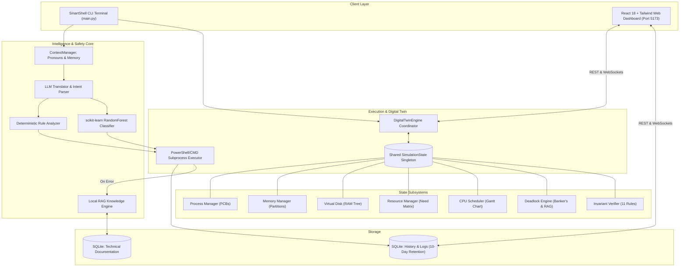
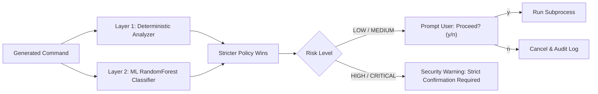

# 🐚 SmartShell: Intelligent Command-Line Operating System Assistant & OS Digital Twin

<div align="center">

[](https://github.com/radhyeshyam7)
[](https://www.python.org/)
[](https://fastapi.tiangolo.com/)
[](https://react.dev/)
[](https://www.typescriptlang.org/)
[](https://tailwindcss.com/)
[](https://scikit-learn.org/)
[](https://ai.google.dev/)
[](https://pytest.org/)
[](LICENSE)

<br />

**A production-ready, context-aware command-line assistant powered by NLP, dual-layer AI safety, and an integrated real-time Operating System Digital Twin.**

[Quick Start](#-quick-start-in-3-minutes) • [Architecture](#-architecture--system-design) • [OS Digital Twin](#-smartshell-os-digital-twin) • [CLI Commands](#-master-cli-command-reference) • [Web Dashboard](#-supporting-web-dashboard) • [Project Guide (PROJECT_GUIDE.md)](PROJECT_GUIDE.md)

</div>

---

## 📌 Table of Contents

- [🌟 Overview & Core Concept](#-overview--core-concept)
- [⚡ Quick Start in 3 Minutes](#-quick-start-in-3-minutes)
- [🏗️ Architecture & System Design](#-architecture--system-design)
- [🛡️ Dual-Layer AI Safety & ML Risk Engine](#-dual-layer-ai-safety--ml-risk-engine)
- [🧠 Real-OS NLP Assistant (Pillar 1)](#-real-os-nlp-assistant-pillar-1)
- [🌐 SmartShell OS Digital Twin (Pillar 2)](#-smartshell-os-digital-twin-pillar-2)
  - [Unified SimulationState Engine](#1-unified-simulationstate-engine)
  - [Subsystem Managers](#2-subsystem-managers)
  - [11 State Invariant Verification Rules](#3-11-state-invariant-verification-rules)
  - [Side-by-Side Algorithm Benchmarking](#4-side-by-side-algorithm-benchmarking)
- [💻 Master CLI Command Reference](#-master-cli-command-reference)
- [🖥️ Supporting Web Dashboard](#-supporting-web-dashboard)
- [🔌 REST API Specification](#-rest-api-specification)
- [📂 Project Directory Structure](#-project-directory-structure)
- [❓ Frequently Asked Questions (FAQ)](#-frequently-asked-questions-faq)
- [📜 License & Acknowledgments](#-license--acknowledgments)

---

## 🌟 Overview & Core Concept

**SmartShell** bridges natural language intent with safe, native shell execution on Windows while providing an observable virtual laboratory for core Operating System concepts.

Traditional shell environments require cryptic syntax and offer zero safety validation. Simultaneously, academic operating system algorithms are frequently taught as disconnected textbook formulas. **SmartShell solves both through a unified dual-engine architecture:**

```text
                                    SMARTSHELL 2.0
                                           |
         +---------------------------------+---------------------------------+
         |                                                                   |
         v                                                                   v
  PILLAR 1: Real OS NLP Assistant                     PILLAR 2: SmartShell OS Digital Twin
  Controls the physical Windows machine               An in-memory virtual OS laboratory
  • Conversational memory & pronoun resolution        • Unified thread-safe SimulationState
  • Disambiguation across drives (C:\, D:\)           • Process Control Blocks (PCBs) & states
  • Dual-layer safety (Regex + scikit-learn ML)       • Dynamic RAM allocation & fragmentation
  • Local RAG diagnostic grounding with citations     • Banker's Algorithm & RAG cycle detection
  • Automated 10-day audit log retention              • CPU Scheduling with visual Gantt charts
```

---

## ⚡ Quick Start in 3 Minutes

### Prerequisites
- **Python 3.10+** (64-bit)
- **Node.js 18+** & **npm 9+**
- (Optional) **Google Gemini API Key** (set in `.env`; core Digital Twin runs 100% offline without it)

### 1. Setup Environment
```powershell
# Clone the repository
git clone https://github.com/radhyeshyam7/SmartShell.git
cd SmartShell

# Create and activate Python virtual environment
python -m venv venv
.\venv\Scripts\Activate.ps1

# Install backend dependencies
.\venv\Scripts\pip.exe install -r backend/requirements.txt
.\venv\Scripts\pip.exe install scikit-learn

# Install frontend dependencies
cd frontend
npm install
cd ..
```

### 2. Configure Environment (`.env`)
Create a `.env` file in the root folder:
```env
GEMINI_API_KEY=your_gemini_api_key_here
GEMINI_MODEL=gemini-3.5-flash-lite
AI_PROVIDER=gemini
ALLOW_ALL_DIRECTORIES=true
LOG_RETENTION_DAYS=10
AUTO_APPROVE_LOW_RISK=false
```

### 3. Launch Services (Open 3 Terminals)

```powershell
# Terminal 1: Backend Server (FastAPI :8000)
.\scripts\start_backend.ps1

# Terminal 2: Supporting Web Dashboard (Vite :5173)
.\scripts\start_frontend.ps1

# Terminal 3: Primary CLI Interface
.\venv\Scripts\python.exe main.py
```

---

## 🏗️ Architecture & System Design

SmartShell separates interface, intelligence, execution, and simulation layers into decoupled services:



---

## 🛡️ Dual-Layer AI Safety & ML Risk Engine

SmartShell **never allows generative AI to authorize command execution**. Every command is independently evaluated through a two-stage verification pipeline:



1. **Deterministic Analyzer**: Regex and path traversal checks block system root modifications (`C:\Windows`), volume formatting (`format C:`), and unauthorized deletions.
2. **scikit-learn ML Classifier**: A `RandomForestClassifier` analyzes command n-grams and predicts risk (`LOW`, `MEDIUM`, `HIGH`, `CRITICAL`).
3. **Behavioral Anomaly Detector**: Maintains a rolling 10-event window tracking command frequency, failure rate spikes, and high-risk bursts, raising security warnings if suspicious activity occurs.

---

## 🧠 Real-OS NLP Assistant (Pillar 1)

SmartShell provides 12 concrete AI/ML operating-system capabilities:

| # | Capability | Description |
| :-: | :--- | :--- |
| **1** | **Context-Aware Memory** | `ContextManager` tracks recent targets, active paths, and commands to resolve pronouns like *"move them to Documents"*. |
| **2** | **Disambiguation & Fallback** | Detects missing target paths and prompts for drive letters, automatically falling back to a safe system-wide search across `C:\`, `D:\`. |
| **3** | **Explainable DAG Planner** | Breaks complex multi-step instructions into a Directed Acyclic Graph with explicit `depends_on` links. |
| **4** | **Actionable Remediation** | Categorizes runtime failures (`path_not_found`, `port_in_use`) and suggests 1-click remediation commands. |
| **5** | **Local RAG Technical Search** | Ingests OS documentation into an embedded SQLite database (`smartshell_rag.db`) to provide grounded troubleshooting citations. |
| **6** | **User Personalization** | Persists user preferences (e.g. preferred venv naming, output formats) and applies them to future requests. |
| **7** | **ML Risk Estimation** | Pairs deterministic safety with a trained `RandomForestClassifier` to assess shell risk. |
| **8** | **Anomaly Detection** | Monitors execution patterns in a rolling window to detect rapid failure spikes or unauthorized privilege escalations. |
| **9** | **Modular AI Factory** | Seamlessly switches between Google Gemini and deterministic offline rule-based translation. |
| **10** | **NLP Benchmark Suite** | Includes an evaluation suite (`eval_suite.py`) testing intent classification and risk prediction accuracy. |
| **11** | **Multi-Drive Execution** | Discovers physical partitions, scans across drives, and identifies duplicate files via SHA-256 chunk hashing. |
| **12** | **10-Day Auto Retention** | Automatically prunes database command history and physical log files older than 10 days on startup. |

---

## 🌐 SmartShell OS Digital Twin (Pillar 2)

Unlike disconnected educational calculators, the **Digital Twin** is a software-simulated operating system environment where **all subsystems mutate and observe a single shared state store (`SimulationState`)**.

### 1. Unified `SimulationState` Engine
- **Logical Clock**: Ticks discrete time steps for CPU cycles and device I/O.
- **Strict Host Isolation**: Virtual files, memory partitions, and virtual processes reside in RAM. **Zero modifications occur on your real Windows filesystem or host processes.**

### 2. Subsystem Managers

#### 🔄 Process Manager (`ProcessManager`)
- Implements standard Process Control Block (PCB) states: `NEW`, `READY`, `RUNNING`, `WAITING`, `TERMINATED`.
- **Automatic Resource Reclaim**: When a virtual process terminates, all held memory partitions and allocated resources are immediately released back to the system pool.

#### 🧠 Memory Manager (`MemoryManager`)
- Contiguous partition allocation supporting **First-Fit**, **Best-Fit**, and **Worst-Fit**.
- Real-time calculation of **Internal Fragmentation** per block and **External Fragmentation** across free memory.
- Virtual Memory Page Replacement simulations (**FIFO**, **LRU**, **Optimal**) with page hit/fault tracking.

#### 💾 Virtual Disk Manager (`DiskManager`)
- Pure in-memory virtual filesystem tree (`/`, `/sys`, `/etc`, `/home`).
- Disk head scheduling simulation (**FCFS**, **SSTF**, **SCAN**, **C-SCAN**, **LOOK**, **C-LOOK**) with seek traversal distance calculation.

#### 🛡️ Deadlock & Resource Manager (`DeadlockManager`)
- Multitype resource tracking (`R1`, `R2`, `R3`) generating live Available, Allocation, Max Claim, and **Need Matrices** ($Need = Max - Allocation$).
- **Banker's Algorithm**: Determines safe states and outputs verified safe execution sequences.
- **Resource Allocation Graph (RAG)**: Depth-First Search (DFS) cycle detection to pinpoint circular wait deadlocks.

#### ⏱️ Virtual CPU Scheduler (`VirtualScheduler`) & I/O
- Simulates **Round Robin** (configurable time quantum), **FCFS**, **SJF**, **SRTF**, and **Priority**.
- Generates visual Gantt chart execution timelines and calculates Average Turnaround Time (TAT), Waiting Time (WT), and CPU Utilization.

### 3. 11 State Invariant Verification Rules
The `VerificationService` deterministically checks 11 mathematical rules:
1. $\sum \text{Partitions} = \text{Total Memory Capacity}$.
2. Zero memory address range overlaps.
3. $\text{Internal Fragmentation} \le \text{Partition Size}$.
4. Allocated blocks reference valid, existing processes.
5. Terminated processes hold 0 memory blocks.
6. Terminated processes hold 0 resource instances.
7. $\text{Available} + \text{Allocated} = \text{Total Declared Resources}$.
8. No process holds more than its declared maximum claim.
9. Ready and Waiting queues are strictly disjoint.
10. If CPU is running a PID, that PID must be in `RUNNING` state.
11. Virtual disk storage does not exceed total quota.

### 4. Side-by-Side Algorithm Benchmarking
Run multiple scheduling algorithms on the **exact same workload** with a single command (`dt compare`) to compare metrics:

| Algorithm | Avg Turnaround Time | Avg Waiting Time | CPU Utilization |
| :--- | :---: | :---: | :---: |
| **FCFS** | 12.8 ms | 7.6 ms | 88.5% |
| **SJF** | 9.4 ms | 4.2 ms | 88.5% |
| **Round Robin (q=2)** | 11.2 ms | 6.0 ms | 88.5% |
| **Priority** | 10.8 ms | 5.6 ms | 88.5% |

💡 **AI Recommendation**: *For this workload, SJF achieved the lowest average waiting time (4.2 ms).*

---

## 💻 Master CLI Command Reference

### Group A: Real Windows OS Commands (Plain English)

| Natural Language Query / Command | Native Shell Generated | Risk Rating | Action |
| :--- | :--- | :---: | :--- |
| `show all python files in this project` | `Get-ChildItem -Filter *.py -Recurse` | 🟢 LOW | Searches directory recursively |
| `how many were there?` | `(Get-ChildItem -Filter *.py -Recurse).Count` | 🟢 LOW | Resolves pronoun *"there"* from memory |
| `search for notes.txt` | Disambiguation prompt → Multi-drive scan | 🟢 LOW | Searches across `C:\`, `D:\` |
| `clean up temp files in ./cache` | `Remove-Item -Path ./cache/* -Recurse` | 🟡 MEDIUM | Deletes files after confirmation |
| `check if port 8000 is open` | `Get-NetTCPConnection -LocalPort 8000` | 🟢 LOW | Checks active port binding |
| `show system specs and memory` | `Get-CimInstance Win32_OperatingSystem` | 🟢 LOW | Gathers CPU/RAM specs |

### Group B: SmartShell OS Digital Twin Commands

| CLI Command | Subsystem | Action & Output |
| :--- | :--- | :--- |
| `dt status` | Engine State | Renders Process PCB table, RAM partitions bar, deadlock status, and invariant report |
| `dt process create P6 burst 5 memory 150 priority 2` | Process Manager | Spawns virtual process, allocates contiguous RAM block, admits to `READY` queue |
| `dt process terminate P1` | Process Manager | Terminates process, deallocates memory, and returns resources to the pool |
| `dt schedule round robin quantum 2` | Scheduler | Runs Round Robin scheduling, prints Gantt chart timeline + TAT/WT metrics |
| `dt schedule sjf` | Scheduler | Simulates Shortest Job First scheduling on active virtual processes |
| `dt compare` | Scenario Service | Benchmarks FCFS, SJF, Round Robin, and Priority side-by-side on identical workload |
| `dt memory allocate P1 120 strategy best_fit` | Memory Manager | Contiguously allocates RAM partition using Best-Fit strategy |
| `dt memory deallocate P1` | Memory Manager | Frees RAM blocks assigned to P1 and eliminates fragmentation |
| `dt memory page lru` | Virtual Memory | Simulates LRU page replacement algorithm with hit/fault ratios |
| `dt disk create /home/user/doc.txt size 4` | Virtual Disk | Writes virtual file in isolated RAM disk (host files untouched) |
| `dt disk schedule c-scan` | Disk Scheduler | Simulates C-SCAN disk arm head seek traversal sequence |
| `dt resource request P1 R1 2` | Resource Manager | Requests 2 instances of resource R1 (blocks process to `WAITING` if unavailable) |
| `dt resource release P1 R1 1` | Resource Manager | Releases resource instances and wakes waiting processes |
| `dt deadlock check` | Deadlock Engine | Solves Banker's Algorithm safe sequence and checks RAG for cycles |
| `dt snapshot create Baseline` | Scenario Service | Saves deep checkpoint of virtual OS state |
| `dt snapshot restore <id>` | Scenario Service | Reverts virtual OS state to saved snapshot |
| `dt verify` | Verification Engine | Validates all 11 state invariant rules |
| `dt reset` | Engine State | Restores default baseline academic virtual OS scenario |

---

## 🖥️ Supporting Web Dashboard

The supporting React 18 + TypeScript Web Dashboard (`http://localhost:5173`) provides real-time visualization:

1. **Dashboard (`/`)**: System health summary, real-time CPU/RAM meters, and quick action launcher.
2. **OS Digital Twin (`/digital-twin`)**: Central virtual OS management hub:
   - *Process Table & PCBs*: Live PCB table, state indicators, and spawn form.
   - *CPU Scheduler & Gantt*: Interactive algorithm selector and Gantt timeline.
   - *Virtual Memory (RAM)*: Color-coded partition allocation bar and fragmentation meters.
   - *Virtual Disk & Files*: In-memory filesystem tree and file viewer.
   - *Deadlock & Banker RAG*: Resource inventory, Banker's safe sequence, and RAG graph status.
   - *What-If & Benchmarking*: Side-by-side comparison tables and snapshot rollbacks.
3. **Process Management (`/processes`)**: Real Windows process table with PID search and termination controls.
4. **CPU Scheduling (`/cpu-scheduling`)**: Standalone CPU scheduling simulator.
5. **Memory Management (`/memory-management`)**: Standalone partition allocator and page replacement simulator.
6. **Concurrency & Sync (`/concurrency`)**: Mutex/Semaphore visualization and Dining Philosophers runner.
7. **Deadlock & IPC (`/deadlock-ipc`)**: Standalone Resource Allocation Graph builder.
8. **Disk Scheduling (`/disk-scheduling`)**: Interactive disk head seek visualizer.
9. **Multi-Drive Files (`/files`)**: Path-restricted file explorer with duplicate file finder.
10. **System Monitor (`/system`)**: Real-time hardware utilization charts.
11. **Command History (`/history`)**: Filterable SQLite execution history synchronized live from the CLI.
12. **Settings (`/settings`)**: Gemini model selector, API key test utility, and theme toggle.

---

## 🔌 REST API Specification

| Endpoint | Method | Payload / Request Body | Description |
| :--- | :---: | :--- | :--- |
| `/api/digital-twin/state` | `GET` | None | Returns full live snapshot of Digital Twin state |
| `/api/digital-twin/reset` | `POST` | None | Resets Digital Twin to baseline state |
| `/api/digital-twin/execute` | `POST` | `{"instruction": "dt schedule round robin"}` | Executes CLI or natural language command on Digital Twin |
| `/api/digital-twin/process/create` | `POST` | `{"pid": "P6", "burst_time": 5, "memory_required": 150, "priority": 2}` | Spawns virtual process and allocates RAM |
| `/api/digital-twin/process/terminate` | `POST` | `{"pid": "P1"}` | Terminates process and releases memory/resources |
| `/api/digital-twin/schedule/run` | `POST` | `{"algorithm": "ROUND_ROBIN", "time_quantum": 2}` | Runs CPU scheduling and updates Gantt chart |
| `/api/digital-twin/memory/allocate` | `POST` | `{"pid": "P1", "size_kb": 120, "strategy": "BEST_FIT"}` | Allocates contiguous RAM partition |
| `/api/digital-twin/disk/file` | `POST` | `{"path": "/home/user/doc.txt", "size_kb": 4, "content": "..."}` | Writes virtual file in isolated RAM disk |
| `/api/digital-twin/resources/request` | `POST` | `{"pid": "P1", "resource_name": "R1", "amount": 2}` | Requests resource instances |
| `/api/digital-twin/resources/release` | `POST` | `{"pid": "P1", "resource_name": "R1", "amount": 1}` | Releases held resource instances |
| `/api/digital-twin/deadlock/check` | `GET` | None | Evaluates Banker's safe sequence and RAG cycles |
| `/api/digital-twin/compare` | `POST` | `{"algorithms": ["FCFS", "SJF", "ROUND_ROBIN"]}` | Runs side-by-side benchmark comparison |
| `/api/digital-twin/snapshots/create` | `POST` | `{"label": "Pre-allocation checkpoint"}` | Creates persistent state snapshot |
| `/api/digital-twin/snapshots/restore` | `POST` | `{"snapshot_id": "snap_123"}` | Restores state to specified snapshot |
| `/api/digital-twin/verify` | `GET` | None | Evaluates all 11 state invariant rules |
| `/api/history` | `GET` | Query params: `search`, `status`, `limit` | Fetches synchronized command history |
| `/api/system/metrics` | `GET` | None | Returns host CPU, RAM, and Disk utilization |

---

## 📂 Project Directory Structure

```text
SmartShell/
├── backend/
│   ├── app/
│   │   ├── ai/                      # AI & NLP Services
│   │   │   ├── context_manager.py   # Session memory & pronoun resolution
│   │   │   ├── gemini_client.py      # Gemini API client with retry failover
│   │   │   ├── local_rag.py         # Local RAG search & citations
│   │   │   ├── personalization.py   # User preference management
│   │   │   ├── planner.py           # DAG Task Planner
│   │   │   └── provider_interface.py # Modular AI provider factory
│   │   ├── api/                     # REST API Routers
│   │   │   ├── digital_twin.py      # Digital Twin REST endpoints
│   │   │   ├── drives.py            # Multi-drive discovery API
│   │   │   ├── history.py           # History & 10-day retention API
│   │   │   ├── simulators.py        # OS concept simulators API
│   │   │   ├── system.py            # System metrics & process management
│   │   │   └── files.py             # File explorer API
│   │   ├── digital_twin/            # SmartShell OS Digital Twin Core
│   │   │   ├── models.py            # Strongly-typed Pydantic schemas
│   │   │   ├── state.py             # Thread-safe SimulationState store
│   │   │   ├── engine.py            # DigitalTwinEngine orchestrator
│   │   │   ├── managers/            # Subsystem Resource Managers
│   │   │   │   ├── process_manager.py  # PCB lifecycles & state transitions
│   │   │   │   ├── memory_manager.py   # Contiguous partition allocation & paging
│   │   │   │   ├── disk_manager.py     # Isolated virtual RAM disk & scheduling
│   │   │   │   ├── resource_manager.py # Resource matrix calculations
│   │   │   │   ├── scheduler.py        # CPU scheduling & Gantt chart engine
│   │   │   │   ├── io_manager.py       # Device queues & blocked states
│   │   │   │   └── deadlock_manager.py # Banker's safety & RAG cycles
│   │   │   └── services/            # Simulation Services
│   │   │       ├── scenario_service.py     # Snapshots & side-by-side benchmarking
│   │   │       └── verification_service.py # 11 state invariant verification rules
│   │   ├── database/                # Database Layer
│   │   │   ├── database.py          # SQLite database connection
│   │   │   └── models.py            # SQLAlchemy models
│   │   ├── execution/               # Execution & Safety Core
│   │   │   ├── anomaly_detector.py  # Behavioral anomaly detector
│   │   │   ├── audit_logger.py      # Unified audit logger
│   │   │   ├── executor.py          # Subprocess executor
│   │   │   ├── ml_risk_estimator.py # scikit-learn RandomForest risk classifier
│   │   │   ├── risk_analyzer.py     # Deterministic safety classifier
│   │   │   └── shell_manager.py     # Cross-platform shell wrapper
│   │   ├── services/                # Host OS Services
│   │   │   ├── drive_service.py     # Multi-drive scanner & hashing
│   │   │   └── simulators.py        # Pure algorithmic simulation functions
│   │   ├── config.py                # Backend settings
│   │   └── main.py                  # FastAPI application entrypoint
│   ├── evaluation/                  # NLP Evaluation Framework
│   │   ├── dataset.json             # Annotated test case dataset
│   │   └── eval_suite.py            # Benchmark evaluation runner
│   └── tests/                       # Pytest Test Suite
│       ├── test_backend.py          # Core backend tests
│       ├── test_digital_twin.py      # Digital Twin integration tests
│       └── test_os_simulators.py    # Simulators and multi-drive tests
├── frontend/                        # React 18 + TypeScript Dashboard
│   ├── src/
│   │   ├── pages/                   # 12 Dashboard Pages
│   │   │   ├── Dashboard.tsx        # Overview & quick metrics
│   │   │   ├── DigitalTwin.tsx      # Unified OS Digital Twin laboratory
│   │   │   ├── ProcessManagement.tsx# Host process manager
│   │   │   ├── CPUScheduling.tsx    # Standalone CPU scheduler visualizer
│   │   │   ├── MemoryManagement.tsx # Standalone memory visualizer
│   │   │   ├── ConcurrencySync.tsx  # Mutex/Dining philosophers
│   │   │   ├── DeadlockIPC.tsx      # Standalone RAG builder
│   │   │   ├── DiskScheduling.tsx   # Standalone disk visualizer
│   │   │   ├── FileExplorer.tsx     # Multi-drive file explorer
│   │   │   ├── SystemMonitor.tsx    # Hardware utilization gauges
│   │   │   ├── CommandHistory.tsx   # Live synced execution history
│   │   │   └── Settings.tsx         # AI model & system settings
│   │   ├── services/api.ts          # Axios client & WebSocket subscriber
│   │   └── App.tsx                  # Routing configuration
├── scripts/                         # Automation Scripts
│   ├── setup_windows.ps1            # Automated one-click setup
│   ├── start_backend.ps1            # Starts FastAPI backend (:8000)
│   └── start_frontend.ps1           # Starts React frontend (:5173)
├── main.py                          # Primary CLI Terminal Entrypoint
├── llm_translate.py                 # Gemini NLP Translator & Intent Parser
├── executor.py                      # Subprocess Command Executor
├── config.py                        # Standalone CLI Configuration
├── smartshell.db                    # SQLite Database (History & Logs)
├── smartshell_rag.db                # Local RAG Knowledge Database
├── PROJECT_GUIDE.md                 # Detailed Project Walkthrough
└── README.md                        # Master Project Documentation
```

## ❓ Frequently Asked Questions (FAQ)

### Q1: Is the Digital Twin a virtual machine like VirtualBox?
**No.** It is a lightweight, in-memory **software simulation** of operating system resources (PCBs, partition tables, allocation matrices, device queues) running with a discrete logical clock. It provides interactive observability without hypervisor overhead.

### Q2: What happens if Gemini API is unreachable or offline?
SmartShell includes deterministic offline rule-based translation. Core Digital Twin operations (`dt status`, `dt schedule`, `dt memory`, `dt deadlock`, `dt verify`, `dt compare`) run **100% offline on CPU** without calling external APIs.

### Q3: How do the CLI and Web Dashboard stay synchronized?
Every CLI command writes to the shared state and persists to SQLite. The FastAPI backend broadcasts execution events over WebSockets directly to the React dashboard.

### Q4: How is database bloat prevented?
SmartShell enforces an automated **10-day retention policy**. On startup, command history records and audit logs older than 10 days are automatically purged from SQLite.

---

## 📜 License & Acknowledgments

This project is licensed under the **MIT License**.

- Built with **Google Gemini AI SDK** (`google-genai`) & **scikit-learn**.
- Backend powered by **FastAPI**, **SQLAlchemy**, and **SQLite**.
- Frontend visualizers built with **React 18**, **TypeScript**, **Tailwind CSS**, and **Lucide Icons**.

---

<div align="center">
  <b>Developed for Intelligent Operating System Automation & Academic OS Education.</b><br />
  <sub>SmartShell 2.0 • Created with ❤️ for students, educators, and power users.</sub>
</div>
